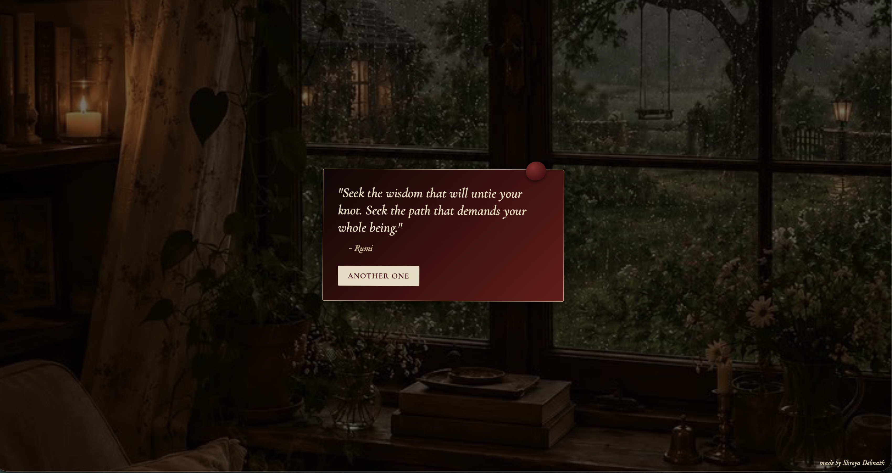
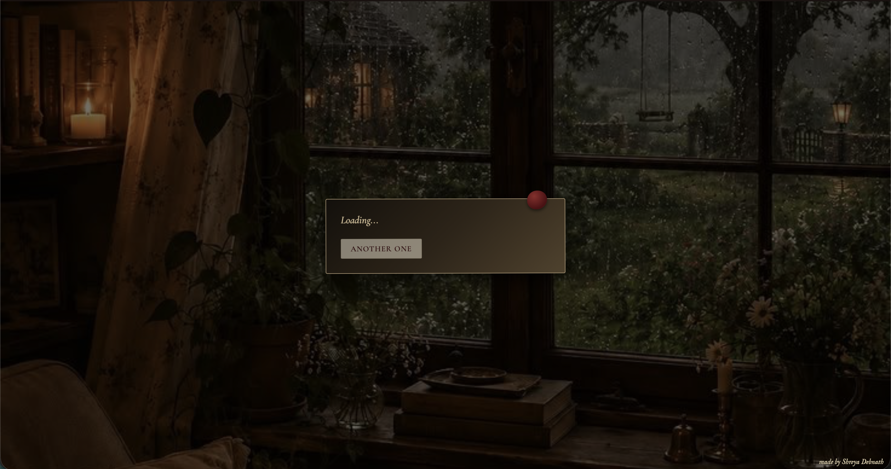
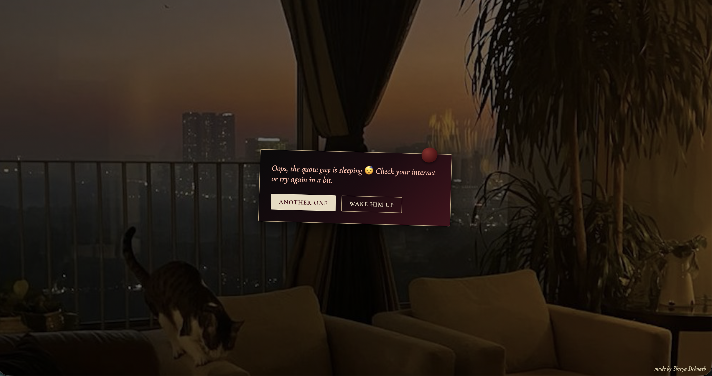
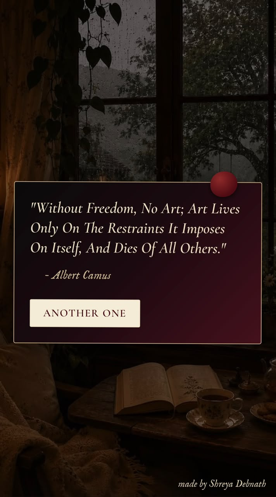
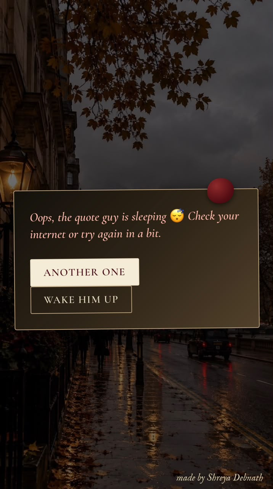
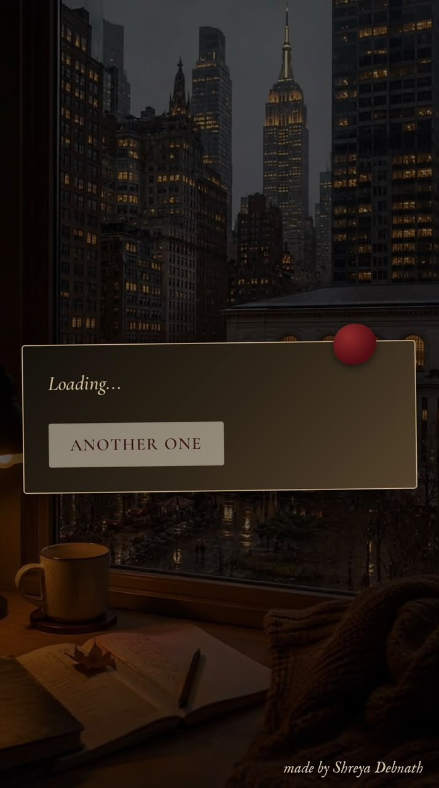

# Little Words

A responsive dark academia random quote generator. It shows a random quote and its author, and every click on "Another one" brings a new quote with a new background photo, a new card colour and a slightly different tilt.

**Live site:** https://genuine-bunny-7c2b55.netlify.app

**Project report (Google Doc):** paste-your-doc-link-here

## Screenshots














## Features
- Shows a random quote and author when the page loads
- "Another one" button fetches a new quote using the Fetch API
- Shows "Loading..." while the quote is being fetched
- Shows a friendly error message ("the quote guy is sleeping") and a retry button if the internet or the API fails
- Background photo fades to a new one with every quote
- The quote card changes between dark gradients (burgundy, cherry red, black, beige) and tilts a little differently each time
- Works on both phones and laptops

## Built with
- HTML
- CSS
- JavaScript (Fetch API, async/await)
- Quotes from the public [DummyJSON](https://dummyjson.com/docs/quotes) API
- Google Fonts (Cormorant Garamond and IM Fell English)

## Project structure
```
index.html   - the page
style.css    - the dark academia styling and the phone layout
script.js    - fetches the quotes and changes the photo, colour and tilt
bg1.jpg ... bg5.jpg - the 5 background photos
```

## How to run it locally
1. Download or clone this repository.
2. Open `index.html` in your browser. You need an internet connection to load the quotes.

## Result


## What I learned
- How to get data from an API with `fetch` and `async/await`
- Why errors need to be handled, because the internet or API can fail
- How to make a page work on both phones and laptops
- How to put a project on GitHub and deploy it for free on Netlify

## Credits
Background photos were collected from Pinterest. All credit to the original photographers and creators.

## Author
Shreya Debnath
